

<picture>
  <source media="(prefers-color-scheme: dark)" srcset="assets/banner-dark.svg">
  
</picture>

  
  
  
  
  
  

  <a href="https://www.nvidia.com/en-us/startups/">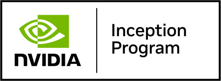</a>&nbsp;
  <a href="https://www.mmintelligence.ai/blog/mm-intelligence-openai-select-partner">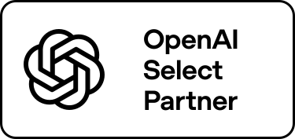</a>&nbsp;
  <a href="https://elevenlabs.io">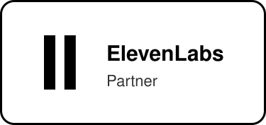</a>&nbsp;
  <a href="https://deepgram.com/startups">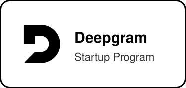</a>&nbsp;

We're an AI-native software company in **Montgomery, Alabama**. We build voice agents, AI systems, automations, and web and mobile apps for businesses in the US and the Gulf, and we run products of our own.

## Products we run

<table>
<tr>
<td width="50%" valign="top">
<a href="https://www.mangoanswers.com">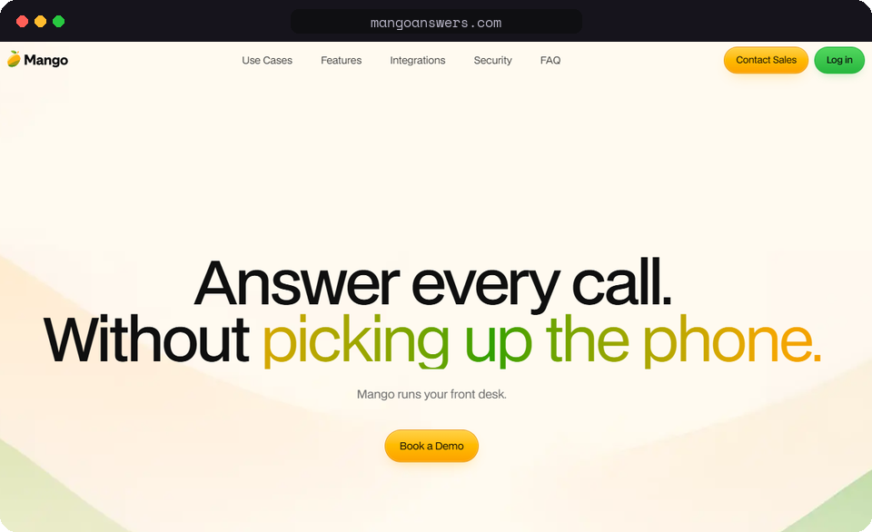</a>
<h3><a href="https://www.mangoanswers.com">Mango</a></h3>
AI front desk that answers every call, books appointments and takes messages.
</td>
<td width="50%" valign="top">
<a href="https://askmgm.com">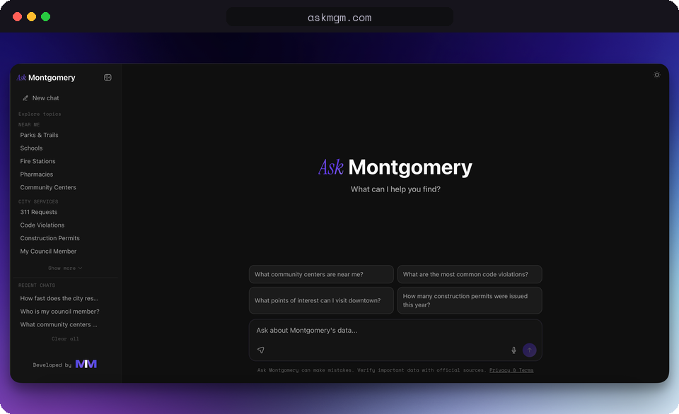</a>
<h3><a href="https://askmgm.com">AskMGM</a></h3>
Ask a question about Montgomery and get an answer from the city's own public data.
</td>
</tr>
<tr>
<td width="50%" valign="top">
<a href="https://whatsgoodmgm.com">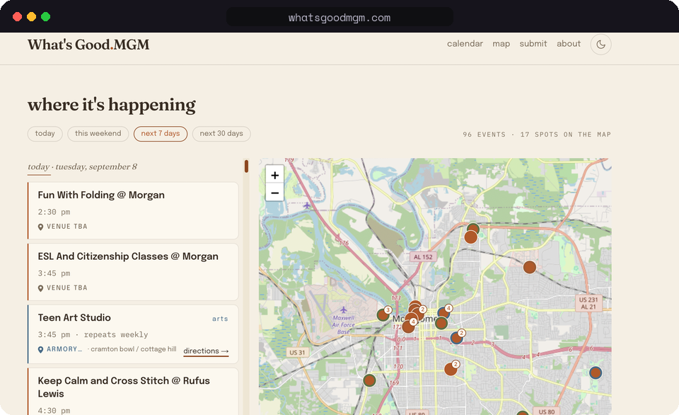</a>
<h3><a href="https://whatsgoodmgm.com">WhatsGoodMGM</a></h3>
A weekly curated guide to what's happening in Montgomery.
</td>
<td width="50%" valign="top">
<a href="https://apps.apple.com/us/app/matemove/id6753686255">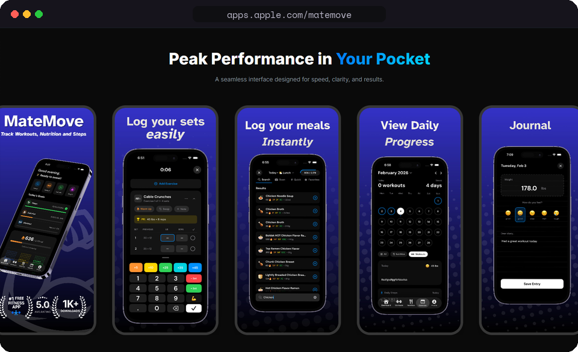</a>
<h3><a href="https://apps.apple.com/us/app/matemove/id6753686255">MateMove</a></h3>
Free, private, all-in-one fitness tracker for iPhone.
</td>
</tr>
</table>

## What we build

<table>
<tr>
<td width="25%" valign="top"><a href="https://www.mmintelligence.ai/services/voice"><b>Voice agents</b></a> Answer the phone, book appointments and take messages, in English and Arabic.</td>
<td width="25%" valign="top"><a href="https://www.mmintelligence.ai/services/chatbots"><b>AI systems</b></a> Answer from your own documents, on your site or on WhatsApp.</td>
<td width="25%" valign="top"><a href="https://www.mmintelligence.ai/services/automation"><b>Automations</b></a> Take the repetitive work off your team's plate.</td>
<td width="25%" valign="top"><a href="https://www.mmintelligence.ai/services/development"><b>Web and mobile apps</b></a> Built and shipped in weeks, not months.</td>
</tr>
</table>

## Our stack

<table>
<tr><td><b>AI and LLMs</b></td><td>
 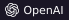  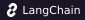 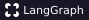  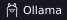
</td></tr>
<tr><td><b>Voice</b></td><td>
  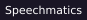 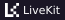
</td></tr>
<tr><td><b>Data and ML</b></td><td>
 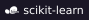  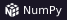   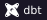 
</td></tr>
<tr><td><b>Languages</b></td><td>
 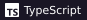 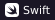 
</td></tr>
<tr><td><b>Apps and infra</b></td><td>
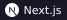 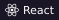  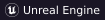  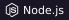 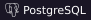        
</td></tr>
</table>

## Latest from the blog

<!-- BLOG-POST-LIST:START -->
- [Teaching Seniors to Use ChatGPT on a Phone: What Worked in Montgomery](https://www.mmintelligence.ai/blog/teaching-seniors-chatgpt-phone-montgomery)
- [The Five Automations That Pay Back Fastest for River Region Small Businesses](https://www.mmintelligence.ai/blog/five-automations-river-region-small-business)
- [Miss Odessa: Building a Voice AI Guide to Montgomery's History Buses](https://www.mmintelligence.ai/blog/miss-odessa-voice-ai-montgomery-history)
- [MM Intelligence Named an OpenAI Select Partner](https://www.mmintelligence.ai/blog/mm-intelligence-openai-select-partner)
- [Building a Beacon Tour for a Historic District (Without Drilling a Single Hole)](https://www.mmintelligence.ai/blog/beacon-tour-historic-district-build)
<!-- BLOG-POST-LIST:END -->

Updated weekly from [our blog](https://www.mmintelligence.ai/blog).

---

**Montgomery, Alabama** &nbsp;·&nbsp; **Manama, Bahrain** 
[info@mmintelligence.ai](mailto:info@mmintelligence.ai) &nbsp;·&nbsp; [Book a call](https://www.mmintelligence.ai/contact) &nbsp;·&nbsp; [mmintelligence.ai](https://www.mmintelligence.ai)

